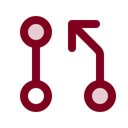

<!-- readme-standard: 2026-11-02 -->
<div align="center">



# 🧪 Solidity Intensive

*A complete Solidity language reference — 18 contract modules covering every core concept from types to DeFi interactions.*


[](https://github.com/drasticstatic/solidity_intensive/actions/workflows/pages/pages-build-deployment)
[](https://github.com/drasticstatic/.github)
[](https://soliditylang.org/)
[](https://hardhat.org/)
[](https://drasticstatic.github.io/solidity_intensive)

 **You are here:** drasticstatic lab › DappU coursework › `solidity_intensive` · public · `main` is the working branch

</div>

##  TL;DR

1.  **What this is.** A Solidity language reference: 18 contract modules, each isolating one concept with Hardhat tests.
2.  **Who it is for.** Anyone learning Solidity who wants a recipe to copy and adapt.
3.  **Do this first.** Browse the [live reference](https://drasticstatic.github.io/solidity_intensive).

## 📖 About

This repository is a structured deep-dive into the Solidity language — built as a personal reference during an intensive blockchain developer bootcamp. Each contract isolates a single concept with clean, commented examples and corresponding Hardhat tests.

Think of it as a Solidity cookbook: every chapter is a standalone recipe you can copy, adapt, and build from.

## 📂 Contract Modules

| Contract | Concept |
|----------|---------|
| `Types.sol` | Value types: `uint`, `int`, `bool`, `address`, `bytes` |
| `Variables.sol` | State, local, and global variables; visibility modifiers |
| `Functions.sol` | Pure, view, payable functions; return values; modifiers |
| `Conditionals.sol` | `if`/`else`, ternary, `require`, `revert` |
| `Loops.sol` | `for`, `while`, `do-while`; gas considerations |
| `Operators.sol` | Arithmetic, logical, bitwise, and comparison operators |
| `Arrays.sol` | Fixed and dynamic arrays; push/pop/delete; memory vs. storage |
| `Mappings.sol` | Key-value mappings; nested mappings; enumeration limitations |
| `Structs.sol` | Custom data types; struct arrays; storage patterns |
| `Enums.sol` | Enumerated types; state machines |
| `Constructors.sol` | Initialization patterns; constructor arguments; ownership |
| `Events.sol` | Emitting events; indexed parameters; frontend subscriptions |
| `Errors.sol` | Custom errors; `require` vs. `revert`; gas savings |
| `Inheritance.sol` | `is` keyword; `virtual`/`override`; multiple inheritance; `super` |
| `Ether.sol` | `msg.value`; `payable`; `transfer`/`send`/`call`; receive/fallback |
| `Time.sol` | `block.timestamp`; time-based access control |
| `Token.sol` | Manual ERC-20 implementation from scratch (no OpenZeppelin) |
| `Interactions.sol` | Calling external contracts; interfaces; low-level `call` |

## 🚀 Getting Started

```bash
git clone https://github.com/drasticstatic/solidity_intensive.git
cd solidity_intensive
npm install
npx hardhat compile
npx hardhat test
```

## 🧪 Running Tests

```bash
# Run all tests with gas reporting
GAS_REPORT=true npx hardhat test

# Run a single test file
npx hardhat test test/Token.js

# Start a local Hardhat node
npx hardhat node
```

## 🛠 Tech Stack

- **Solidity** `^0.8` — EVM smart contract language
- **Hardhat** — development environment, testing framework, local EVM node
- **ethers.js** — JavaScript library for contract interaction in tests
- **Node.js** — runtime for scripts and tests

## 🔗 Live Reference

**[drasticstatic.github.io/solidity_intensive](https://drasticstatic.github.io/solidity_intensive)** — browse all modules in a navigable reference

---

*Part of the [DAPPU Blockchain Developer Bootcamp](https://github.com/drasticstatic) curriculum.*
*Maintained by [drasticstatic](https://github.com/drasticstatic)*

##  Suggest a change

Noticed something? Open an [issue](../../issues) or a pull request against `main`; Christopher reads them and a person with the role merges. Not on GitHub? Reach Christopher through [his contact page](https://drasticstatic.github.io/resume/pages/contact.html).

<sub>The front door follows the living [README standard](https://github.com/drasticstatic/my-template/blob/main/README-STANDARD.md). Copy it, improve it.</sub>
